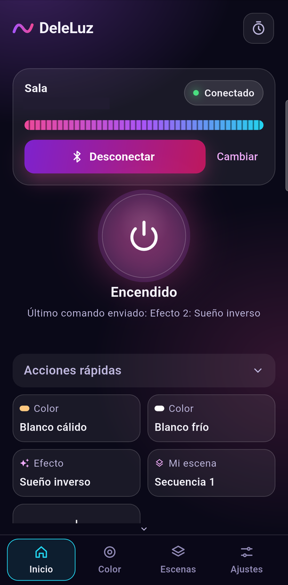
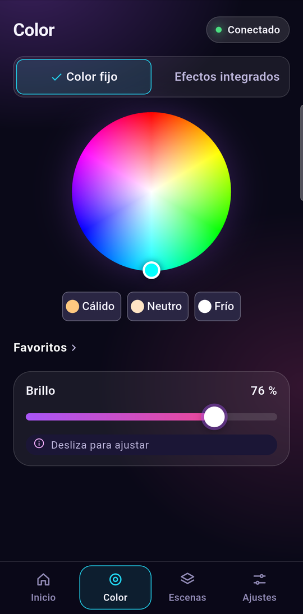

# DeleLuz

Control your LEDDMX-03 LED strip from your phone over Bluetooth. No account, no internet.

## Descargar (Android)

1. Abre la página de [**Releases**](https://github.com/LCubero/deleluz/releases/latest) y descarga **`DeleLuz-1.0.0.apk`**. Es un solo archivo y sirve en cualquier celular Android 7.0 o más nuevo.
2. Ábrelo en el celular. Si Android lo pide, permite instalar apps de esa fuente. Si aparece Google Play Protect, elige instalar de todas formas: la app no viene de la tienda.
3. Abre **DeleLuz**, toca **Conectar** y elige tu tira (`LEDDMX-03-…`).

Las versiones nuevas se instalan encima y conservan tus tiras, alias y escenas. En iPhone no está disponible.

## Download (Android)

1. Open the [**Releases**](https://github.com/LCubero/deleluz/releases/latest) page and download **`DeleLuz-1.0.0.apk`**. It is one file and works on any Android phone with Android 7.0 or newer.
2. Open it on the phone. If Android asks, allow installing apps from that source. If Google Play Protect warns, choose to install anyway: the app is not from the store.
3. Open **DeleLuz**, tap **Conectar** and pick your strip (`LEDDMX-03-…`).

New versions install over the old one and keep your strips, aliases and scenes. Not available for iPhone.

## Novedades de Android (aún no publicadas)

La fase 1 está en `feat/app-polish`: probada en un celular; la revisión de compatibilidad con más celulares sigue en curso. La descarga de arriba no incluye estos cambios.

- **Color:** disco con saturación y blancos Cálido, Neutro y Frío. Se usa el mismo selector en Color, Acciones rápidas y los pasos de color de Mis escenas.
- **Efectos integrados:** búsqueda y favoritos con estrella al principio. El **AUTO de la app** muestra el nombre del efecto y cambia cada 10 s, 30 s, 1 min o 5 min, con Todos o Favoritos. Solo funciona con la app en primer plano y la tira conectada; el **Ciclo de la tira** es independiente.
- **Mis escenas:** hasta ocho pasos de color o efecto integrado, cada uno con su duración. Las escenas anteriores siguen funcionando. **Acciones rápidas** sustituye a Escenas rápidas: elige primero el tipo y luego la acción, incluidos efectos.
- **Temporizador:** anillo de cuenta regresiva, hora de apagado, botones +5 y +15 min y tiempo personalizado en minutos y segundos, con un máximo de 12 h.
- **Bluetooth:** tarjeta visible si está apagado, avisos con iconos y errores claros, con límites de reintentos y tiempos de espera en BLE.

## What's new on Android (unreleased)

Phase 1 is on `feat/app-polish`: tested on one phone, with wider phone compatibility testing in progress. The download above does not include these changes.

- **Color:** a saturation disc with Warm, Neutral, and Cool white presets. The same picker is used in Color, Quick actions, and color steps in My scenes.
- **Built-in effects:** search the catalog and star favorites to list them first. **App AUTO** shows the effect name and advances every 10 s, 30 s, 1 min, or 5 min, using All or Favorites. It runs only in the foreground while connected; the **Strip cycle** is separate.
- **My scenes:** up to eight color or built-in effect steps, each with its own duration. Older scenes still work. **Quick actions** replaces Quick scenes: choose a type, then an action, including effects.
- **Timer:** countdown ring, shutoff time, +5 and +15 min buttons, and custom minutes and seconds, capped at 12 hours.
- **Bluetooth:** a prominent card when Bluetooth is off, notices with icons, and clear errors, with bounded BLE retries and timeouts.

## What it looks like

These screenshots show the published app, not the unreleased polish.

| Inicio | Color | Escenas | Elegir tira |
|---|---|---|---|
|  |  |  |  |

**[List of the 210 built-in effects / Lista de los 210 efectos integrados](docs/EFFECTS.md)**, with the number and name shown in the app.

## For developers

- **Android app source and build**: [`app/`](app/README.md).
- **Phone web app** (Android Chrome): [`webapp/`](webapp/README.md).
- **Protocol lab and notes**: [`lab/`](lab/README.md), [`docs/PROTOCOL.md`](docs/PROTOCOL.md), [`docs/CAPABILITIES.md`](docs/CAPABILITIES.md).

<!-- repo-harness-builder:start -->
<!-- doc-role:repository-harness -->
## Repository Harness

This repository uses a generated documentation and continuity harness. Start with [`REPO-HARNESS.md`](REPO-HARNESS.md) for working rules and [`docs/repo-harness/usage.md`](docs/repo-harness/usage.md) for the human workflow.

The content between the `repo-harness-builder` markers is the builder-managed section. Content outside the markers belongs to the repository's maintainers.
<!-- repo-harness-builder:end -->

## License

MIT, see [LICENSE](LICENSE). DeleLuz is an independent project and is not affiliated with the makers of the LEDDMX-03 controller or the LED LAMP app; protocol notes come from observing the hardware.
