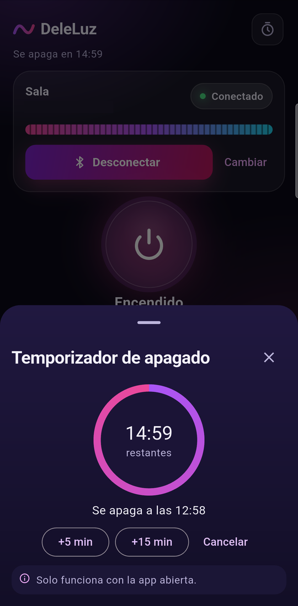

# DeleLuz

Control your LEDDMX-03 LED strip from your phone over Bluetooth. No account, no internet.

## Descargar (Android)

1. Abre la página de la [**versión 1.1.0**](https://github.com/LCubero/deleluz/releases/tag/v1.1.0) y descarga **`DeleLuz-1.1.0.apk`**, el APK universal para Android 7.0 o más nuevo.
2. Ábrelo en el celular. Si Android lo pide, permite instalar apps de esa fuente. Si aparece Google Play Protect, elige instalar de todas formas: la app no viene de la tienda.
3. Abre **DeleLuz**, toca **Conectar** y elige tu tira (`LEDDMX-03-…`).

La release también incluye APK por arquitectura: `DeleLuz-1.1.0-arm64-v8a.apk`, `DeleLuz-1.1.0-armeabi-v7a.apk` y `DeleLuz-1.1.0-x86_64.apk`. Si no sabes cuál, descarga `DeleLuz-1.1.0.apk`.

Instala 1.1.0 encima de 1.0.0 o de una versión de prueba firmada con la misma clave para conservar tus datos. Si desinstalas la app, pierdes tiras guardadas, alias, escenas, acciones rápidas, favoritos y ajustes: la copia de seguridad de Android está desactivada. La tira conserva su propia configuración. No disponible en iPhone.

## Download (Android)

1. Open the [**v1.1.0 release**](https://github.com/LCubero/deleluz/releases/tag/v1.1.0) page and download **`DeleLuz-1.1.0.apk`**, the universal APK for Android 7.0 or newer.
2. Open it on the phone. If Android asks, allow installing apps from that source. If Google Play Protect warns, choose to install anyway: the app is not from the store.
3. Open **DeleLuz**, tap **Conectar** and pick your strip (`LEDDMX-03-…`).

The release also includes per-architecture APKs: `DeleLuz-1.1.0-arm64-v8a.apk`, `DeleLuz-1.1.0-armeabi-v7a.apk`, and `DeleLuz-1.1.0-x86_64.apk`. If unsure, download `DeleLuz-1.1.0.apk`.

Install 1.1.0 over 1.0.0 or a test build signed with the same key to keep your data. Uninstalling removes saved strips, aliases, scenes, quick actions, favorites, and settings: Android backup is disabled. The strip keeps its own settings. Not available for iPhone.

## Novedades de la versión 1.1.0

- **Color:** disco con saturación y blancos Cálido, Neutro y Frío. Se usa el mismo selector en Color, Acciones rápidas y los pasos de color de Mis escenas.
- **Efectos integrados:** búsqueda y favoritos con estrella al principio. El **AUTO de la app** muestra el nombre del efecto y cambia cada 10 s, 30 s, 1 min o 5 min, con Todos o Favoritos. Solo funciona con la app en primer plano y la tira conectada; el **Ciclo de la tira** es independiente.
- **Mis escenas:** hasta ocho pasos de color o efecto integrado, cada uno con su duración. Las escenas anteriores siguen funcionando. **Acciones rápidas** sustituye a Escenas rápidas: elige primero el tipo y luego la acción, incluidos efectos.
- **Temporizador:** anillo de cuenta regresiva, hora de apagado, botones +5 y +15 min y tiempo personalizado en minutos y segundos, con un máximo de 12 h.
- **Conexión:** toca la tarjeta de Inicio para abrir **Elegir tira** y toca una tira guardada o cercana para conectarla. Desliza la tarjeta de Inicio para previsualizar otra tira guardada sin cambiar de pestaña ni conectarla. Si Bluetooth está apagado, la app muestra un aviso destacado.

## What's new in 1.1.0

- **Color:** a saturation disc with Warm, Neutral, and Cool white presets. The same picker is used in Color, Quick actions, and color steps in My scenes.
- **Built-in effects:** search the catalog and star favorites to list them first. **App AUTO** shows the effect name and advances every 10 s, 30 s, 1 min, or 5 min, using All or Favorites. It runs only in the foreground while connected; the **Strip cycle** is separate.
- **My scenes:** up to eight color or built-in effect steps, each with its own duration. Older scenes still work. **Quick actions** replaces Quick scenes: choose a type, then an action, including effects.
- **Timer:** countdown ring, shutoff time, +5 and +15 min buttons, and custom minutes and seconds, capped at 12 hours.
- **Connection:** tap the Home card to open **Choose strip**, then tap a saved or nearby strip to connect. Swipe the Home card to preview another saved strip without switching tabs or connecting. If Bluetooth is off, the app shows a prominent notice.

## What it looks like

Las capturas muestran la versión 1.1.0. / These screenshots show version 1.1.0.

| Inicio | Color fijo | Escenas | Temporizador |
|---|---|---|---|
|  |  |  |  |

**[List of the 210 built-in effects / Lista de los 210 efectos integrados](docs/EFFECTS.md)**, with the number and name shown in the app.

## For developers

- **Android app source and build**: [`app/`](app/README.md).
- **Phone web app** (Android Chrome): [`webapp/`](webapp/README.md).
- **Protocol lab and notes**: [`lab/`](lab/README.md), [`docs/PROTOCOL.md`](docs/PROTOCOL.md), [`docs/CAPABILITIES.md`](docs/CAPABILITIES.md).

<!-- repo-harness-builder:start -->
<!-- doc-role:repository-harness -->
## Repository Harness

This repository uses a generated documentation and continuity harness. Start with [`REPO-HARNESS.md`](REPO-HARNESS.md) for working rules and [`docs/repo-harness/usage.md`](docs/repo-harness/usage.md) for the human workflow.

The content between the `repo-harness-builder` markers is the builder-managed section. Content outside the markers belongs to the repository's maintainers.
<!-- repo-harness-builder:end -->

## License

MIT, see [LICENSE](LICENSE). DeleLuz is an independent project and is not affiliated with the makers of the LEDDMX-03 controller or the LED LAMP app; protocol notes come from observing the hardware.
