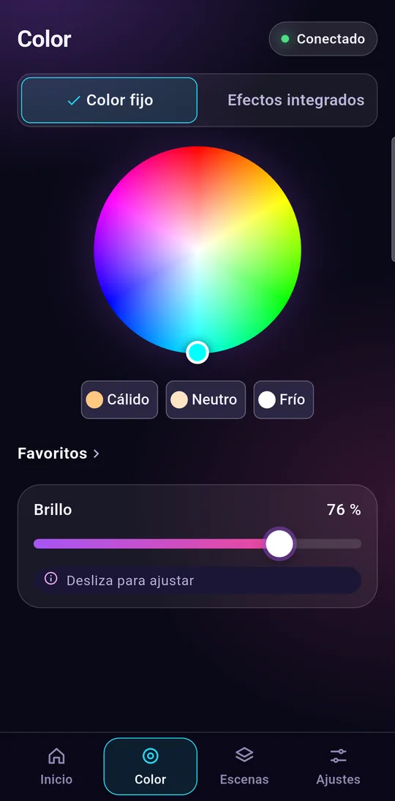
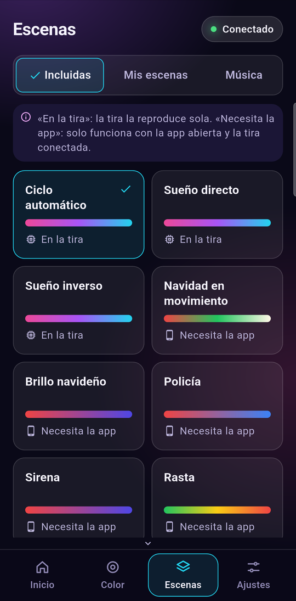

# DeleLuz

Control your LEDDMX-03 LED strip from your phone over Bluetooth. No account, no internet.

## Descargar (Android)

1. Abre la página de la [**versión 1.2.0**](https://github.com/LCubero/deleluz/releases/tag/v1.2.0) y descarga **`DeleLuz-1.2.0.apk`**, el APK universal para Android 7.0 o más nuevo.
2. Ábrelo en el celular. Si Android lo pide, permite instalar apps de esa fuente. Si aparece Google Play Protect, elige instalar de todas formas: la app no viene de la tienda.
3. Abre **DeleLuz**, toca **Conectar** y elige tu tira (`LEDDMX-03-…`).

La versión también incluye APK por arquitectura: `DeleLuz-1.2.0-arm64-v8a.apk`, `DeleLuz-1.2.0-armeabi-v7a.apk` y `DeleLuz-1.2.0-x86_64.apk`. Si no sabes cuál, descarga `DeleLuz-1.2.0.apk`.

Instala 1.2.0 encima de 1.1.0, 1.0.0 o una versión de prueba firmada con la misma clave para conservar tus datos. Si desinstalas la app, pierdes tiras guardadas, alias, escenas, acciones rápidas, favoritos y ajustes: la copia de seguridad de Android está desactivada. La tira conserva su propia configuración. No disponible en iPhone.

## Download (Android)

1. Open the [**v1.2.0 release**](https://github.com/LCubero/deleluz/releases/tag/v1.2.0) page and download **`DeleLuz-1.2.0.apk`**, the universal APK for Android 7.0 or newer.
2. Open it on the phone. If Android asks, allow installing apps from that source. If Google Play Protect warns, choose to install anyway: the app is not from the store.
3. Open **DeleLuz**, tap **Conectar** and pick your strip (`LEDDMX-03-…`).

The release also includes per-architecture APKs: `DeleLuz-1.2.0-arm64-v8a.apk`, `DeleLuz-1.2.0-armeabi-v7a.apk`, and `DeleLuz-1.2.0-x86_64.apk`. If unsure, download `DeleLuz-1.2.0.apk`.

Install 1.2.0 over 1.1.0, 1.0.0, or a test build signed with the same key to keep your data. Uninstalling removes saved strips, aliases, scenes, quick actions, favorites, and settings: Android backup is disabled. The strip keeps its own settings. Not available for iPhone.

## Novedades de la versión 1.2.0

- **Escenas:** las etiquetas y la leyenda distinguen **Necesita la app** de **En la tira**. Los efectos de la tira aparecen primero y se marca la última escena o modo de Música que se inició correctamente.
- **Efectos integrados:** nombres traducidos al español, con búsqueda en español e inglés.
- **Interfaz:** pestañas y avisos sin saltos, mejor distribución en pantallas estrechas y botones más fáciles de tocar al elegir una tira.

## What's new in 1.2.0

- **Scenes:** labels and a legend show which scenes need the app and which run on the strip. Strip effects appear first, and the last successfully started scene or Music mode is marked.
- **Built-in effects:** translated names in Spanish, with search in Spanish and English.
- **Layout:** tabs and status messages stay in place, the layout fits narrow screens better, and strip chooser buttons are easier to tap.

## What it looks like

Las capturas muestran la versión 1.2.0. / These screenshots show version 1.2.0.

| Inicio | Color fijo | Escenas | Temporizador |
|---|---|---|---|
|  |  |  |  |

**[List of the 210 built-in effects / Lista de los 210 efectos integrados](docs/EFFECTS.md)**, with the number and name shown in the app.

## For developers

- **Android app source and build**: [`app/`](app/README.md).
- **Phone web app** (Android Chrome): [`webapp/`](webapp/README.md).
- **Protocol lab and notes**: [`lab/`](lab/README.md), [`docs/PROTOCOL.md`](docs/PROTOCOL.md), [`docs/CAPABILITIES.md`](docs/CAPABILITIES.md).

<!-- repo-harness-builder:start -->
<!-- doc-role:repository-harness -->
## Repository Harness

This repository uses a generated documentation and continuity harness. Start with [`REPO-HARNESS.md`](REPO-HARNESS.md) for working rules and [`docs/repo-harness/usage.md`](docs/repo-harness/usage.md) for the human workflow.

The content between the `repo-harness-builder` markers is the builder-managed section. Content outside the markers belongs to the repository's maintainers.
<!-- repo-harness-builder:end -->

## License

MIT, see [LICENSE](LICENSE). DeleLuz is an independent project and is not affiliated with the makers of the LEDDMX-03 controller or the LED LAMP app; protocol notes come from observing the hardware.
