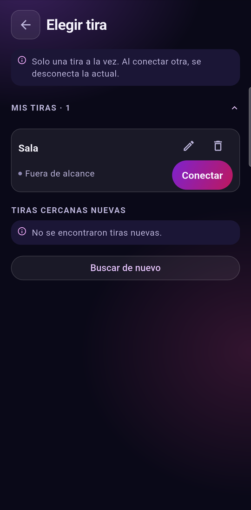

# DeleLuz

Control your LEDDMX-03 LED strip from your phone over Bluetooth. No account, no internet.

## Descargar (Android)

1. Abre la página de [**Releases**](https://github.com/LCubero/deleluz/releases/latest) y descarga **`DeleLuz-1.0.0.apk`**. Es un solo archivo y sirve en cualquier celular Android 7.0 o más nuevo.
2. Ábrelo en el celular. Si Android lo pide, permite instalar apps de esa fuente. Si aparece Google Play Protect, elige instalar de todas formas: la app no viene de la tienda.
3. Abre **DeleLuz**, toca **Conectar** y elige tu tira (`LEDDMX-03-…`).

Las versiones nuevas se instalan encima y conservan tus tiras, alias y escenas. En iPhone no está disponible.

## Download (Android)

1. Open the [**Releases**](https://github.com/LCubero/deleluz/releases/latest) page and download **`DeleLuz-1.0.0.apk`**. It is one file and works on any Android phone with Android 7.0 or newer.
2. Open it on the phone. If Android asks, allow installing apps from that source. If Google Play Protect warns, choose to install anyway: the app is not from the store.
3. Open **DeleLuz**, tap **Conectar** and pick your strip (`LEDDMX-03-…`).

New versions install over the old one and keep your strips, aliases and scenes. Not available for iPhone.

## What it looks like

| Inicio | Color | Escenas | Elegir tira |
|---|---|---|---|
|  |  |  |  |

**[List of the 210 built-in effects / Lista de los 210 efectos integrados](docs/EFFECTS.md)**, with the number and name shown in the app.

## For developers

- **Android app source and build**: [`app/`](app/README.md).
- **Phone web app** (Android Chrome): [`webapp/`](webapp/README.md).
- **Protocol lab and notes**: [`lab/`](lab/README.md), [`docs/PROTOCOL.md`](docs/PROTOCOL.md), [`docs/CAPABILITIES.md`](docs/CAPABILITIES.md).

<!-- repo-harness-builder:start -->
<!-- doc-role:repository-harness -->
## Repository Harness

This repository uses a generated documentation and continuity harness. Start with [`REPO-HARNESS.md`](REPO-HARNESS.md) for working rules and [`docs/repo-harness/usage.md`](docs/repo-harness/usage.md) for the human workflow.

The content between the `repo-harness-builder` markers is the builder-managed section. Content outside the markers belongs to the repository's maintainers.
<!-- repo-harness-builder:end -->

## License

MIT, see [LICENSE](LICENSE). DeleLuz is an independent project and is not affiliated with the makers of the LEDDMX-03 controller or the LED LAMP app; protocol notes come from observing the hardware.
