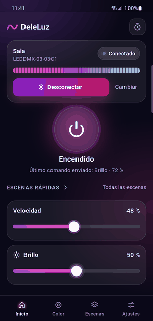

# DeleLuz Android app

Native Android app (Flutter) for the LEDDMX-03 LED strip controller, with the Glow Glass design of the phone webapp ([`../webapp/README.md`](../webapp/README.md)). It is shared as an APK, not through an app store. iPhone builds need macOS and are not covered here.

<p align="center"></p>

## Install

1. Download `DeleLuz-1.0.0.apk` from the [Releases](https://github.com/LCubero/deleluz/releases/latest) page. It is one file for every Android phone with Android 7.0 or newer.
2. Open it on the phone and allow installing apps from that source. Google Play Protect may warn because the app is not from the store.
3. Updates install over the previous version and keep your data.

If you installed a test build from before 1.0.0, uninstall it once first: it was signed with a different key. That removes its saved strips, aliases and scenes.

## What it does

- **Inicio**: the device card shows the strip by alias (Bluetooth name below), its status and a preview of what was last sent. One button connects, reconnects, disconnects, or cancels a pending connection. Swipe the name to show your other saved strips in a loop (dots show which one); tap Conectar to switch. **Cambiar** opens the strip selector. Also power (disabled while disconnected), brightness, speed (enabled only for effects), quick scenes, up to six shortcuts, and the off timer.
- **Color**: hue wheel, the shared Favoritos palette (up to 15), built-in effects 1–210 with vendor names, or Auto cycle. Opens on Color fijo.
- **Escenas**: Mis escenas (1–8 colors, speed, brightness, up to 12 scenes), included scenes, and Música (four strip-microphone modes and their sensitivity). Opens on Mis escenas.
- **Elegir tira** (from Cambiar or Ajustes → Dispositivos): your saved strips and new nearby strips. Each row has rename (pencil), forget (trash) and one Conectar/Desconectar button; long-press for the same menu. Errors show on the row with Reintentar. Search appears with four or more strips.
- **Ajustes**: Dispositivos; Configuración del dispositivo (color order and LED count, saved per strip and sent only when connected and after a confirmation); language (Spanish default, English); help; privacy; Acerca de.

Horizontal drags on sliders and color pickers never switch tabs; swipe elsewhere on the page to change tab.

## Connection

One strip connected at a time; several can be saved, each with an alias that stays on this phone. Up to 4 connect tries, 300 ms apart, and Cancelar stops them at once. Commands are spaced 50 ms apart, and a new slider value replaces the unsent one. A deliberate disconnect releases the strip so another phone or app can connect. The app shows what it last sent, not the strip's real state: the controller reports nothing back. Wire format: [`../docs/PROTOCOL.md`](../docs/PROTOCOL.md).

## Limits

- Scene playback and the off timer run only while the app is in front. The strip has no timer of its own.
- Shortcuts are reordered from the long-press menu, not by dragging.
- No per-LED control is known for this controller.
- No automatic update notice: install a newer APK over the old one.

## Privacy and permissions

The app asks for Bluetooth permissions only when you connect or search. On Android 12 and newer, nearby-device scanning does not use location; on Android 11 and older, Android requires the location permission to scan. The app makes no network requests and does not use the phone microphone, notifications, or accounts. Settings, saved strips and aliases stay on the phone: Android backup and device-to-device transfer are turned off for the app.

## Build

From `app/`, with the Flutter SDK in `../_tools/flutter` (not on `PATH`):

```sh
../_tools/flutter/bin/flutter test
../_tools/flutter/bin/flutter build apk --release   # build/app/outputs/flutter-apk/app-release.apk, published as DeleLuz-<version>.apk
```

Release signing reads `android/key.properties`, which points to a keystore under `android/release/`. Both are git-ignored; keep a private backup, because updates must be signed with the same key. Without `key.properties`, release builds fall back to the debug key, which is only for local testing. `key.properties` format:

```properties
storePassword=<password>
keyPassword=<password>
keyAlias=deleluz
storeFile=../release/deleluz-release.jks
```

Raise the build number in `pubspec.yaml` (`version: 1.0.0+N`) for every APK you share; Android only installs an update over a lower number. It starts at 2004 because earlier test builds were split per ABI and used codes up to 2003. Keep `lib/version.dart` in sync with the version name (a test checks it).

On Windows the release build sometimes fails with `stableIds.txt ... The device does not recognize the command`; delete `build/app/intermediates/stable_resource_ids_file` and build again.

On Windows, Kotlin incremental compilation is turned off in `android/gradle.properties` because plugin sources in the pub cache live on another drive.
